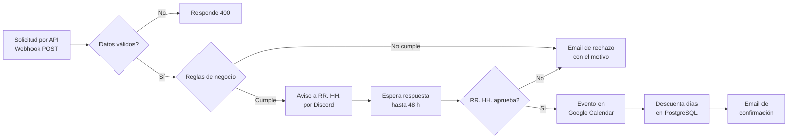

# Gestión de vacaciones con aprobación de RR. HH.

Workflow de **n8n** que automatiza todo el circuito de solicitud de vacaciones de una empresa: desde que el empleado hace el pedido hasta que queda agendado y descontado de sus días disponibles.

*[English below](#english)*

## Qué problema resuelve

Pedir vacaciones suele ser un ida y vuelta de emails: el empleado pide, RR. HH. revisa a mano si le quedan días, responde, alguien lo anota en el calendario y otro actualiza la planilla. Este flujo hace todo eso solo y deja a RR. HH. únicamente la decisión de aprobar o rechazar.

## Cómo funciona



1. **Recepción:** el empleado envía nombre, email, fecha de inicio, fecha de retorno y comentarios a un webhook `POST` protegido con autenticación por header.
2. **Validación de datos** (nodo Code en JavaScript): campos obligatorios, formato de email y de fechas (`YYYY-MM-DD`), que el inicio sea anterior al retorno y comentarios de hasta 500 caracteres. Responde `400 Bad Request` con la lista de errores, o `200 OK`.
3. **Reglas de negocio:**
   - La solicitud se hace con al menos **7 días de anticipación**.
   - Los días solicitados son **más de 0** (se cuentan días corridos).
   - El empleado tiene **días disponibles suficientes**, consultando PostgreSQL.
4. **Aprobación humana (human-in-the-loop):** se envía un mensaje a RR. HH. por Discord con los datos y un link para aprobar o rechazar. El flujo queda en pausa hasta 48 h esperando la respuesta.
5. **Resultado:**
   - **Aprobada:** crea el evento en Google Calendar, descuenta los días en la base de datos y envía un email de confirmación al empleado.
   - **Rechazada** (por una regla o por RR. HH.): envía un email al empleado explicando el motivo.

## Tecnologías

`n8n` · `JavaScript` · `PostgreSQL (Neon)` · `Webhooks` · `Discord` · `Gmail` · `Google Calendar`

## Cómo usarlo

1. En n8n: **Workflows → Import from File** y elegí `workflow.json`.
2. Configurá tus credenciales en cada nodo: Header Auth (webhook y espera), PostgreSQL, Discord Webhook, Gmail y Google Calendar.
3. En el nodo de Google Calendar, reemplazá `TU_CALENDAR_ID` por el ID de tu calendario.
4. Creá la tabla en PostgreSQL:

```sql
CREATE TABLE "days off" (
  id            SERIAL PRIMARY KEY,
  email         TEXT UNIQUE NOT NULL,
  vacation_days NUMERIC NOT NULL DEFAULT 0,
  sick_days     NUMERIC NOT NULL DEFAULT 0
);
```

### Ejemplo de solicitud

```bash
curl -X POST https://TU-N8N/webhook/vacations/ask/form/001 \
  -H "Content-Type: application/json" \
  -H "TU_HEADER: TU_SECRETO" \
  -d '{
    "Nombre completo": "Juan Pérez",
    "Correo electronico": "juan.perez@empresa.com",
    "Fecha inicio ": "2026-12-01",
    "Fecha retorno": "2026-12-08",
    "Comentarios": "Viaje familiar"
  }'
```

---

## English

**n8n** workflow that automates a company's full time-off request process: it receives the request through an authenticated webhook, validates the data and business rules (7-day notice, available days checked in PostgreSQL), asks HR for approval on Discord and waits up to 48 h, then creates the Google Calendar event, updates the employee's remaining days and sends a confirmation email. Rejections (by a rule or by HR) notify the employee with the reason.

**Stack:** n8n · JavaScript · PostgreSQL · Webhooks · Discord · Gmail · Google Calendar

---

Autor: **Gonzalo Moreiro** · [LinkedIn](https://www.linkedin.com/in/gonzalo-moreiro/)
